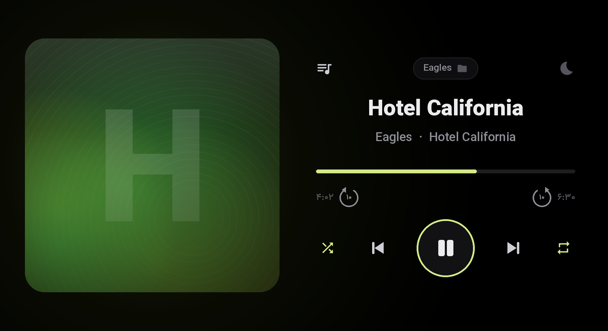
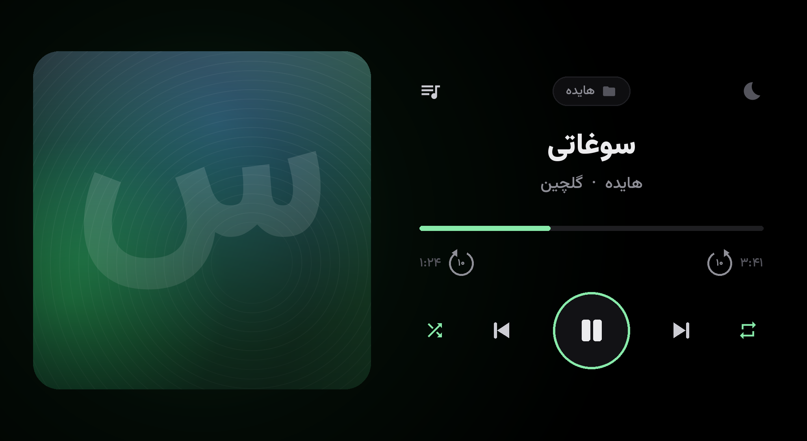

# GeekMusic

**A pure-black USB / SD-card music player for Android car head units.**

[](https://github.com/mani-imani/GeekMusic/actions/workflows/build.yml)
[](https://github.com/mani-imani/GeekMusic/releases/latest)
[](LICENSE)
[-3DDC84?logo=android&logoColor=white)](#compatibility)

[فارسی](README.md) · Sibling project: [GeekPlay](https://github.com/mani-imani/GeekPlay) (Bluetooth music)



GeekMusic replaces the head unit's stock music player with the same night-first design as [GeekPlay](https://github.com/mani-imani/GeekPlay): true black, big touch targets and colours taken from each song's artwork. It plays straight from the USB stick or SD card plugged into the car.

## Features

**Playback**
- Draggable seek bar plus **±10 s** buttons
- Shuffle, repeat (off / all / one)
- **Resume where you left off:** if music was playing when the car turned off, it continues from the same second on ignition or when the USB stick is mounted
- **Steering-wheel keys** (next / previous / play-pause)
- Handles phone calls and navigation prompts: pauses or ducks, then continues on its own
- Pauses the phone's Bluetooth music automatically so two streams never overlap

**Library**
- **Folder tree exactly as on the stick / card**, with natural sorting (`2` before `10`)
- All songs, artists and albums
- **Search** across title, artist, album and file name, tolerant of Arabic/Persian letter variants (`ي`/`ی`, `ك`/`ک`)
- *Play all* / *shuffle* for any folder, artist or album
- Mini player at the bottom of the library
- Tapping the cover or the folder chip opens the library at the playing song's folder

**Look**
- True black (`#000`), night dim (−50%), Vazirmatn font and Persian digits
- **Real album art**, from the file itself or `cover.jpg` / `folder.jpg`. The UI accent comes from the cover's dominant colour
- Songs without art get unique generated artwork (same algorithm as GeekPlay)
- **Repairs garbled Persian tags:** tags that show up as `ÓæÛÇÊí` instead of Persian are displayed correctly
- Adaptive layout that scales to fit any screen

| فارسی | English |
|:---:|:---:|
|  |  |

## Compatibility

| | |
|---|---|
| **Car** | JAC S3 |
| **Head unit** | ZQ8003 · board `ZQ_MTK_8007` · MediaTek |
| **Android** | 8.0+ (built for Android 9) |
| **Formats** | MP3 · FLAC · M4A/AAC · WAV · OGG · OPUS |

Playback and the library use only standard Android APIs and work on any Android 8+ device. The audio-source and steering-wheel hand-over targets the vendor `car` service used by this family of head units (`android.car.server`). On other units that part is silently skipped.

## Install

1. Download `GeekMusic.apk` from the [latest release](https://github.com/mani-imani/GeekMusic/releases/latest).
   Direct link: `https://github.com/mani-imani/GeekMusic/releases/latest/download/GeekMusic.apk`
2. Install it on the head unit. You can open the link in the unit's browser over a phone hotspot, or copy the APK over on a USB stick.
3. On first launch, allow access to files.

## How it works

We decompiled the stock player (`android.car.app.media`). It plays with Android's standard `MediaPlayer` and finds music under `/storage`, so GeekMusic uses the same tools. The only head-unit-specific part is cooperating with the vendor `car` service:

- When another app plays audio, the `car` service switches the unit to the generic *other app* source (`EmptySource`). GeekMusic requests that same switch when playback starts. This stops the radio or Bluetooth audio, and the unit then delivers steering-wheel keys as standard Android media keys.
- A `MediaSession` receives those keys. When the app is on screen, the activity also handles them directly.

See [`CarSource.java`](app/src/main/java/ir/maniimani/geekmusic/CarSource.java). The [GeekPlay README](https://github.com/mani-imani/GeekPlay/blob/main/README.en.md#how-it-works) explains how the protocol was found.

## Building

GitHub Actions builds every push to `main`. When `versionName` changes, the APK is also published to Releases automatically.

```bash
# JDK 17 + Android SDK (compileSdk 34) + Gradle 8.7
gradle assembleRelease
```

To release, bump `versionName` and `versionCode` in `app/build.gradle`, add a `## x.y.z` section to `CHANGELOG.md`, and push.

> The signing key (`app/geekmusic.keystore`) is committed on purpose so every build installs over the previous one. This is a sideloaded personal app, and the key is not meant for Google Play.

## Project structure

```
app/src/main/java/ir/maniimani/geekmusic/
├── MainActivity.java       Now-playing screen, layout, wiring
├── LibraryPanel.java       Folders / songs / artists / albums / search + mini player
├── PlayerService.java      MediaPlayer, queue, shuffle/repeat, audio focus, MediaSession, resume
├── Library.java            Storage discovery, folder tree, MediaStore + tag reading, tag cache
├── CarSource.java          Hand-over of audio source / steering keys on the head unit
├── Text.java               Persian digits, search normalisation, natural sort, tag repair
├── Art.java                Generated covers + palette from real artwork
├── ArtworkView.java        Rounded cover with cross-fade
├── SeekView.java           Draggable seek bar
├── SkipButton.java         ±10 s buttons
├── PlayButton.java         Always-circular play/pause
├── GlowView.java           Black background with a soft coloured bloom
├── Thumbs.java             Cached list thumbnails
├── Track.java · Folder.java
└── AutoResumeReceiver.java Resume after ignition / USB mount
```

## Built with Claude

Like GeekPlay, this project was built from idea to finished app with **[Claude](https://claude.ai)** by Anthropic, on a **Claude Pro** plan. Claude worked through every stage: analysing the stock player and the head unit's system service, designing the UI, writing the player and library code and setting up CI. I did the real-car testing and made the design decisions.

## Author

**Mani ImaniSanjar** · [GeekMani](https://t.me/geekmani)
[maniimani.ir](https://maniimani.ir) · [GitHub](https://github.com/mani-imani) · [LinkedIn](https://linkedin.com/in/mani-imani)

## License

Code is released under the [MIT](LICENSE) license. The bundled [Vazirmatn](https://github.com/rastikerdar/vazirmatn) font is under the SIL OFL 1.1.

This is an independent project, not affiliated with the head unit manufacturer or JAC Motors. Screenshots are UI previews, and the song titles are used only as examples.
