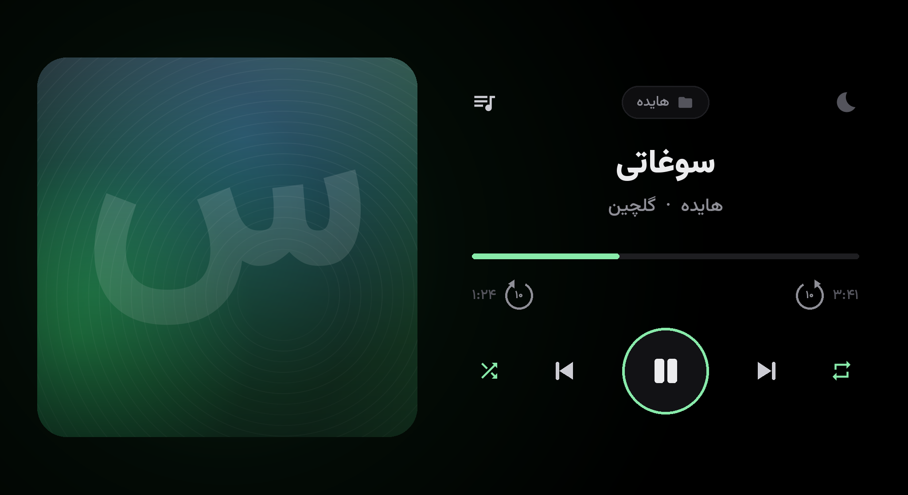
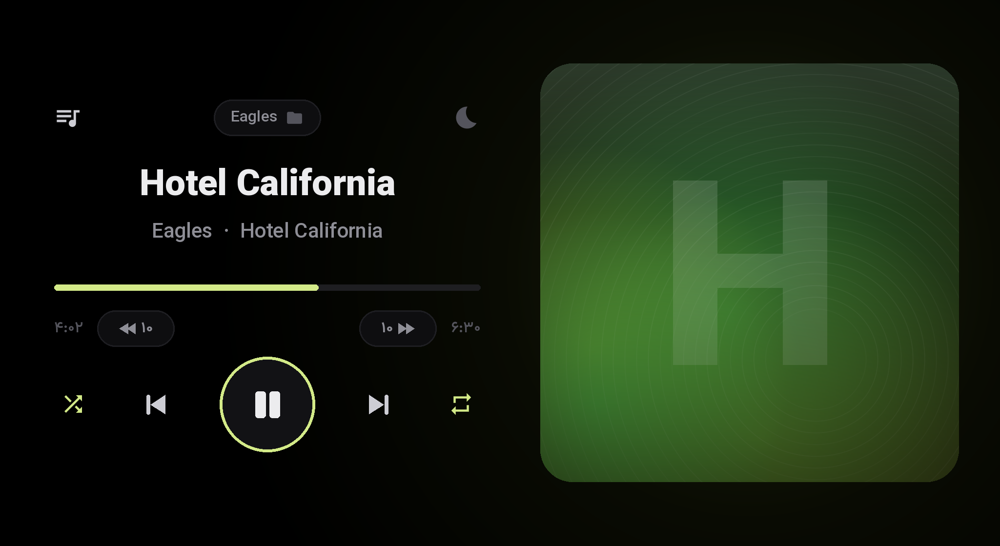

<div dir="rtl">

# DrivePlay

**پلیر موزیک فلش و کارت حافظه با تم مشکی کامل، برای مانیتورهای اندرویدی ماشین**

[](https://github.com/mani-imani/DrivePlay/actions/workflows/build.yml)
[](https://github.com/mani-imani/DrivePlay/releases/latest)
[](LICENSE)
[-3DDC84?logo=android&logoColor=white)](#سازگاری)

[English README](README.en.md) · برادرش: [BlueTune](https://github.com/mani-imani/BlueTune) (پلیر موزیک بلوتوث) · [DoorAlert](https://github.com/mani-imani/DoorAlert) (هشدار باز موندن در)



DrivePlay جایگزین پلیر موزیک خود مانیتور ماشینه، با همون طراحی [BlueTune](https://github.com/mani-imani/BlueTune): پس‌زمینه‌ی مشکی کامل که شب چشم رو اذیت نکنه، دکمه‌های بزرگ و رنگی که از کاور هر آهنگ گرفته می‌شه. آهنگ‌ها مستقیم از فلش و کارت حافظه‌ای که به ماشین وصله پخش می‌شن.

## ویژگی‌ها

**پخش**
- نوار زمان قابل کشیدن، به‌علاوه‌ی دکمه‌های **۱۰ ثانیه جلو و عقب**
- پخش تصادفی و تکرار (بدون تکرار، تکرار همه، تکرار یک آهنگ)
- **ادامه‌ی پخش از همون ثانیه:** اگه موقع خاموش کردن ماشین آهنگ در حال پخش بوده، با روشن شدن دوباره‌ی ماشین، پخش خودش از همون‌جا ادامه پیدا می‌کنه؛ لازم نیست اپ رو باز کنی. اگه خودت قبلش پخش رو متوقف کرده باشی، ادامه نمی‌ده
- کار با **دکمه‌های روی فرمون** (بعدی، قبلی، پخش و توقف)
- رفتار درست در تماس تلفنی و پیغام‌های مسیریاب: موسیقی قطع یا آروم می‌شه و بعد خودش ادامه پیدا می‌کنه
- اگه موزیک بلوتوث گوشی در حال پخش باشه، خودکار متوقف می‌شه تا دو صدا با هم پخش نشن

**کتابخونه**
- **پوشه‌بندی دقیقاً مثل خود فلش و کارت حافظه**، با مرتب‌سازی طبیعی (فایل `2` قبل از `10` میاد)
- همه‌ی آهنگ‌ها، خواننده‌ها و آلبوم‌ها
- **جستجو** توی اسم آهنگ، خواننده، آلبوم و اسم فایل. «ي» و «ی» یا «ك» و «ک» فرقی نمی‌کنن
- «پخش همه» و «پخش تصادفی» برای هر پوشه، خواننده یا آلبوم
- مینی‌پلیر پایین صفحه‌ی کتابخونه
- با زدن روی کاور یا اسم پوشه، کتابخونه دقیقاً توی پوشه‌ی آهنگ در حال پخش باز می‌شه

**ظاهر**
- مشکی کامل (`#000`)، حالت شب (۵۰٪ تیره‌تر) و فونت وزیرمتن با اعداد فارسی
- **کاور واقعی** آهنگ، از داخل خود فایل یا عکس `cover.jpg` و `folder.jpg` توی پوشه. رنگ صفحه از رنگ غالب کاور گرفته می‌شه
- برای آهنگ‌هایی که کاور ندارن، یه کاور اختصاصی ساخته می‌شه (همون الگوریتم BlueTune)
- **درست کردن تگ‌های فارسی خراب:** تگ‌هایی که به‌جای فارسی به شکل `ÓæÛÇÊí` ذخیره شدن، درست نمایش داده می‌شن
- چیدمان خودش رو با اندازه‌ی صفحه تنظیم می‌کنه
- **تمام‌صفحه:** نوار بالای مانیتور پنهان می‌شه و با کشیدن یا لمس لبه‌ی بالای صفحه چند ثانیه نمایش داده می‌شه
- ساعت بالای کاور
- دکمه‌ها سمت چپ صفحه، یعنی سمت راننده، و کاور سمت راست

<div dir="ltr">

| فارسی | English |
|:---:|:---:|
|  |  |

</div>

## سازگاری

| | |
|---|---|
| **ماشین** | جک S3 (JAC S3) |
| **مانیتور** | ZQ8003 · برد `ZQ_MTK_8007` · MediaTek |
| **اندروید** | ۸ به بالا، برای اندروید ۹ ساخته شده |
| **فرمت‌ها** | MP3 · FLAC · M4A/AAC · WAV · OGG · OPUS |

پخش و کتابخونه با ابزارهای استاندارد خود اندروید ساخته شدن و روی هر دستگاه اندرویدی کار می‌کنن. هماهنگی با منبع صدای مانیتور و دکمه‌های فرمون برای سرویس `car` همین خانواده از مانیتورها (`android.car.server`) نوشته شده. روی مانیتورهای دیگه این بخش بی‌سروصدا کنار گذاشته می‌شه.

## نصب

1. فایل `DrivePlay.apk` رو از [آخرین Release](https://github.com/mani-imani/DrivePlay/releases/latest) دانلود کن.
   لینک مستقیم: `https://github.com/mani-imani/DrivePlay/releases/latest/download/DrivePlay.apk`
2. روی مانیتور نصبش کن. می‌تونی مانیتور رو به هات‌اسپات گوشی وصل کنی و لینک رو توی مرورگرش باز کنی، یا APK رو با فلش منتقل کنی.
3. بار اول که اپ رو باز می‌کنی، اجازه‌ی دسترسی به فایل‌ها رو بده.

> اگه نسخه‌ی قدیمی این اپ با اسم GeekMusic روی مانیتورت هست، اول پاکش کن. شناسه‌ی اپ عوض شده و این دو تا جدا نصب می‌شن.

## خاموش و روشن کردن ماشین

مانیتور موقع خاموش شدن ماشین می‌ره توی حالت خواب و همه‌ی اپ‌هایی که خودت نصب کردی رو کامل می‌بنده (Force stop). اپ بسته‌شده پیام‌های معمولی اندروید مثل «روشن شدن» و «وصل شدن فلش» رو دریافت نمی‌کنه. ولی خود سیستم مانیتور قبل از خواب و بعد از بیدار شدن پیام‌هایی می‌فرسته (`android.car.action.ENTER_SLEEP`، `EXIT_SLEEP` و `CAR_BOOT_COMPLETED`) که به اپ‌های بسته‌شده هم می‌رسه:

- **قبل از خواب:** DrivePlay یادداشت می‌کنه که موزیک در حال پخش بوده یا نه. اگه خود مانیتور در آخرین لحظه‌ها پخش رو قطع کرده باشه هم پخش حساب می‌شه، ولی اگه خودت دکمه‌ی توقف رو زده باشی نه.
- **بعد از بیدار شدن:** اگه پخش بوده، DrivePlay تا ۴۵ ثانیه صبر می‌کنه تا فلش یا کارت حافظه دوباره وصل بشه و آهنگ رو از همون ثانیه ادامه می‌ده.

**برای ماشین مشکلی ایجاد نمی‌کنه.** این پیام‌ها رو خود سیستم مانیتور برای همه می‌فرسته و DrivePlay فقط گوش می‌ده. هیچ دستوری به ماشین فرستاده نمی‌شه و موقع خواب هم هیچ کاری در پس‌زمینه انجام نمی‌شه.

## چطور کار می‌کنه

اپ موزیک خود مانیتور (`android.car.app.media`) رو باز کردیم و بررسی کردیم. پخش رو با `MediaPlayer` استاندارد اندروید انجام می‌ده و آهنگ‌ها رو از مسیرهای `/storage` پیدا می‌کنه. DrivePlay هم از همین ابزارها استفاده می‌کنه. تنها بخش مخصوص این مانیتور، هماهنگی با سرویس سیستمی `car` بود:

- وقتی یه اپ دیگه موسیقی پخش می‌کنه، سرویس `car` منبع صدای مانیتور رو روی حالت «اپ دیگه» (`EmptySource`) می‌ذاره. DrivePlay موقع شروع پخش همین درخواست رو خودش می‌فرسته. این‌طوری صدای رادیو یا بلوتوث قطع می‌شه و دکمه‌های فرمون به شکل کلیدهای استاندارد مدیا به اپ می‌رسن.
- دکمه‌های فرمون رو یه `MediaSession` می‌گیره. اگه اپ روی صفحه باز باشه، خود اپ مستقیم جوابشون رو می‌ده.

کد این بخش توی [`CarSource.java`](app/src/main/java/ir/maniimani/driveplay/CarSource.java) هست. روش کلی پیدا کردن این پروتکل توی README پروژه‌ی [BlueTune](https://github.com/mani-imani/BlueTune#چطور-کار-میکنه) توضیح داده شده.

## ساخت از سورس

با هر push به `main`، GitHub Actions اپ رو می‌سازه. اگه `versionName` عوض شده باشه، APK خودکار توی Releases هم منتشر می‌شه.

<div dir="ltr">

```bash
# JDK 17 + Android SDK (compileSdk 34) + Gradle 8.7
gradle assembleRelease
```

</div>

برای انتشار یه نسخه‌ی جدید، `versionName` و `versionCode` رو توی `app/build.gradle` بالا ببر، یادداشت‌های نسخه رو با عنوان `## x.y.z` به `CHANGELOG.md` اضافه کن و push کن.

> کلید امضا (`app/driveplay.keystore`) عمداً توی ریپو گذاشته شده تا هر نسخه‌ی جدید روی نسخه‌ی قبلی نصب بشه. این اپ برای نصب دستیه و این کلید برای Google Play در نظر گرفته نشده.

## ساختار پروژه

<div dir="ltr">

```
app/src/main/java/ir/maniimani/driveplay/
├── MainActivity.java       Now-playing screen, layout, wiring
├── LibraryPanel.java       Folders / songs / artists / albums / search + mini player
├── PlayerService.java      MediaPlayer, queue, shuffle/repeat, audio focus, MediaSession, resume
├── Library.java            Storage discovery, folder tree, MediaStore + tag reading, tag cache
├── CarSource.java          Hand-over of audio source / steering keys on the head unit
├── Text.java               Persian digits, search normalisation, natural sort, tag repair
├── Art.java                Generated covers + palette from real artwork
├── ArtworkView.java        Rounded cover with cross-fade
├── SeekView.java           Draggable seek bar
├── SkipButton.java         ±10 s buttons
├── PlayButton.java         Always-circular play/pause
├── GlowView.java           Black background with a soft coloured bloom
├── Thumbs.java             Cached list thumbnails
├── Track.java · Folder.java
└── SleepReceiver.java      Resume after ignition off/on (vendor sleep/wake broadcasts)
```

</div>

## ساخته‌شده با Claude

این پروژه، مثل BlueTune، از ایده تا نسخه‌ی نهایی با کمک **[Claude](https://claude.ai)** ساخته شد، دستیار هوش مصنوعی شرکت Anthropic، روی اشتراک **Claude Pro**. Claude توی همه‌ی مراحل نقش داشت: بررسی کد پلیر و سرویس سیستمی خود مانیتور، طراحی رابط کاربری، نوشتن کد پلیر و کتابخونه و راه‌اندازی بیلد خودکار. تست روی ماشین واقعی و تصمیم‌های طراحی هم کار خودم بود.

## سازنده

**مانی ایمانی‌سنجر** · [GeekMani](https://t.me/geekmani)
[maniimani.ir](https://maniimani.ir) · [GitHub](https://github.com/mani-imani) · [LinkedIn](https://linkedin.com/in/mani-imani)

## مجوز

کد با مجوز [MIT](LICENSE) منتشر شده. فونت [وزیرمتن](https://github.com/rastikerdar/vazirmatn) با مجوز SIL OFL 1.1 همراه اپ قرار گرفته.

این پروژه مستقله و هیچ ارتباطی با سازنده‌ی مانیتور یا خودروسازی جک نداره. عکس‌های این صفحه پیش‌نمایش رابط کاربری‌ان، و اسم آهنگ‌ها فقط برای نمونه آورده شدن.

</div>
